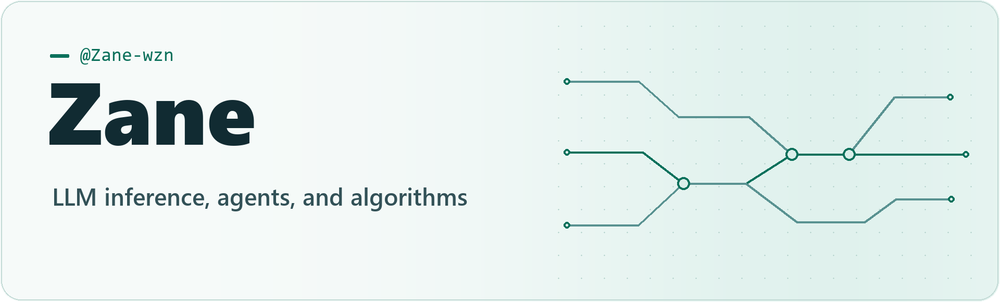

  <picture>
    <source media="(prefers-color-scheme: dark)" srcset="assets/banner-dark.png" />
    <source media="(prefers-color-scheme: light)" srcset="assets/banner-light.png" />
    
  </picture>
  
Information and Computing Science undergraduate at Wuhan University of Technology

  

    <a href="#research-interests">Research</a> &nbsp;·&nbsp;
    <a href="#featured-projects">Projects</a> &nbsp;·&nbsp;
    <a href="#selected-experience">Experience</a> &nbsp;·&nbsp;
    <a href="https://github.com/Zane-wzn?tab=repositories">Repositories ↗</a>
  

<table>
  <tr>
    <td width="25%" align="center">
       
      <strong>Python</strong> Experiments
    </td>
    <td width="25%" align="center">
       
      <strong>PyTorch</strong> Model training
    </td>
    <td width="25%" align="center">
       
      <strong>TypeScript</strong> Agent apps
    </td>
    <td width="25%" align="center">
       
      <strong>Git</strong> Version control
    </td>
  </tr>
</table>

## About me

I'm interested in building LLM agents that can act within clear constraints and use fewer model calls. My background in competitive programming has shaped how I approach that work. I like breaking tasks into steps that can be tested independently and measuring the cost of each step.

At Wuhan University of Technology, I study Information and Computing Science in the School of Mathematics and Statistics. I rank **1st of 29** in my major by both GPA and overall assessment.

## Research interests

| Area | What I work on |
| :--- | :--- |
| **LLM inference efficiency** | Reducing model calls and measuring trade-offs among latency, token usage, and output quality. |
| **Agent runtime design** | Separating reusable plans from runtime decisions and validating generated outputs against a schema. |
| **Model training and evaluation** | Supervised fine-tuning, GRPO, and designing evaluation criteria for generative tasks. |

## Featured projects

<table>
  <tr>
    <td width="50%" valign="top">
      <h3>Kronos Forecasting Experiments</h3>
      
Evaluate a financial time-series foundation model on daily A-share data. The repository covers adapter tuning, continual learning, cross-sectional ranking, and portfolio backtests.

      
<code>Python</code> <code>Time series</code> <code>Continual learning</code>

      
<a href="https://github.com/Zane-wzn/kronos-stock-forecast">Repository ↗</a> · <a href="https://github.com/Zane-wzn/kronos-stock-forecast/tree/main/experiments">Experiment records ↗</a>

    </td>
    <td width="50%" valign="top">
      <h3>Yantu Coordinate Agent · 研途坐标</h3>
      
A workspace for STEM students navigating recommendation-based graduate admissions in China. It turns a résumé into an application profile, matches prospective supervisors, and drafts editable outreach emails.

      
<code>TypeScript</code> <code>Next.js</code> <code>LLM applications</code>

      
<a href="https://github.com/Zane-wzn/yantu-coordinate-agent">Repository ↗</a>

    </td>
  </tr>
</table>

## Selected experience

### Huawei · On-device LLM agents

Worked on an on-device UI generation proof of concept. I helped separate reusable skill compilation from runtime generation, defined constraints for model-generated UI updates, and fine-tuned Qwen models for UI tasks. I evaluated the results by output accuracy, generation time, and token usage.

### 3D Gaussian Splatting · Reconstruction and relighting

Reproduced and debugged PyTorch implementations of 3D Gaussian Splatting. I ran relighting experiments to study how well the reconstructed appearance of objects with subsurface scattering held up under changing illumination.

## Competitions and honors

- **ICPC** · Bronze medals at the 50th ICPC Asia regional contests in Xi’an and Shenzhen
- **Global Campus AI Algorithm Elite Competition** · National first prize
- **RAICOM** · National third prize
- **National Scholarship** · 2024–2025 academic year

  <a href="https://github.com/Zane-wzn#js-contribution-activity">GitHub contribution activity ↗</a>
  &nbsp;·&nbsp;
  <a href="https://github.com/Zane-wzn/znwang-blog">Blog source ↗</a>

